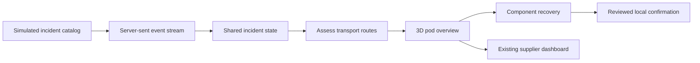

# FORMA: supplier risk and production planning

A shared hackathon workspace for infrastructure delivery, supplier intelligence and recovery planning:

- **POD overview at `/`**: inspect a DSX POD inspired 3D container, switch to wireframe or 2D, and select ten tracked subsystems. Red and amber markers identify disrupted deliveries.
- **Component recovery at `/planning?component=compute-a`**: inspect the affected supplier shipment, compare transport alternatives, and explicitly confirm a recovery route. Incoming simulated incidents update availability and ETA without refreshing.
- **Supplier intelligence at `/suppliers`**: Simon's existing dashboard, with 10,000 anonymized suppliers, maps, profiles and optional analyst chat.
- **Manufacturing planning at `/planning`**: the original FORMA order and manufacturing demo remains available.

Simon’s frontend is the design template for every view: shared controls, theme colors, typography, rounded surfaces and animations. **Reset view** restores the full 3D model after switching modes or moving the camera. The new pod's supplier assignments, geometry, transport costs and incident scenarios are illustrative. They are not actual NVIDIA supplier reports, live flight/rail data or an official CAD model. The supplier directory and manufacturing demo keep their separate datasets.



See [the overview and push workflow](docs/DSX_OVERVIEW.md) and [dataset assumptions](docs/DSX_DATA.md).

## Start locally

Use **Node.js 22.12 or later** and npm. In an existing checkout:

```sh
npm ci
npm run dev
```

Open **http://localhost:3000** for the pod overview, **http://localhost:3000/suppliers** for supplier intelligence and **http://localhost:3000/planning** for the manufacturing demo. Stop the server with Ctrl+C. No credentials or Python installation are needed to explore the bundled supplier data or run the planning demo. Map tiles and climate panels use public network services.

`package-lock.json` is the canonical JavaScript lockfile. `npm ci` also applies the checked-in `metal-fx` patch. Use `npm run build` followed by `npm start` to run the production build on port 3000.

Repository: [Sy-D/openai-devday-hackathon-oct-berlin](https://github.com/Sy-D/openai-devday-hackathon-oct-berlin). The original frontend integration was merged into main in [PR #2](https://github.com/Sy-D/openai-devday-hackathon-oct-berlin/pull/2); the earlier FORMA draft is preserved at `c89d43b` on `codex/forma-first-draft`. Both branches are available to teammates. See [the handoff](docs/HANDOFF.md) for verification and hosting status.

## Optional AI features

Keep credentials server-side in the ignored root `.env` file. If no `.env` exists, copy `.env.example` to `.env`, then fill in only the providers you intend to use. Do not overwrite an existing configuration or commit secrets. Restart the server after changing configuration.

| Feature | Requirements |
| --- | --- |
| Planning copilot at `/planning` | `OPENAI_API_KEY`; optional `OPENAI_MODEL`. Without a key, it uses an explicitly labelled deterministic demo reply. |
| Supplier dataset analyst | Python setup below, `data/suppliers.duckdb`, and `NEBIUS_API_KEY`. |
| Standalone company research | Python setup below, `NEBIUS_API_KEY` and `TAVILY_API_KEY`. No dashboard UI. |

The two AI integrations have separate configuration. Setting an OpenAI key does not configure the supplier agents. Never prefix secrets with `NEXT_PUBLIC_` or `VITE_`. Planning API details and the one-request live check are in [docs/AI.md](docs/AI.md).

### Supplier agent setup

Install Python 3.12 or later, then run these commands from the repository root:

```sh
python3 -m venv deep-research-agent/.venv
deep-research-agent/.venv/bin/pip install -r deep-research-agent/requirements.txt
deep-research-agent/.venv/bin/python scripts/create_duckdb.py
```

The last command builds the local database used by the dataset analyst. The dashboard itself queries the CSV files directly. For a different interpreter, set `ANALYST_PYTHON` to its absolute path before starting Next.js.

Supplier defaults are `NEBIUS_MODEL=MiniMaxAI/MiniMax-M3` and `NEBIUS_BASE_URL=https://api.tokenfactory.nebius.com/v1`. Research streams progress while it runs; duration depends on provider and search response times.

The research agent UI is currently removed. Its backend and CLI remain available:

```sh
cd deep-research-agent
.venv/bin/python app.py "Robert Bosch GmbH"          # score one supplier
.venv/bin/python app.py --jobs 2 "Bosch" "Siemens"   # several in parallel
.venv/bin/python analyst.py "Your risk question"     # sourced web-research answer
```

The standalone `analyst.py` is separate from the dashboard's dataset analyst, which uses `scripts/ask.py`. See [the agent README](deep-research-agent/README.md) and [pipeline overview](deep-research-agent/OVERVIEW.md).

### Docker

The Docker configuration packages Node.js and Python in one container:

```sh
docker compose up --build
```

It serves the same application routes on port 3000. Optional provider values come from the root `.env`; research results persist in the `agent-output` volume. Docker CI verified the original integration build. Runtime provider configuration still needs its own check.

## Using the supplier dashboard

- **Search**: start typing or press Cmd+K / Ctrl+K. Arrow keys and Enter open a supplier profile; Cmd/Ctrl+Enter sends the text to the analyst chat.
- **Analyst chat**: asks the configured Nebius model to generate a read-only SQL query over the local supplier database, then explains the result. It supports follow-up questions and optional structured answer blocks. This feature needs the Python setup and Nebius key above.
- **Table and filters**: sort columns and filter by risk level, maximum total or financial risk, minimum delivery rating and sourcing risk.
- **Selection and chart**: select suppliers to focus the chart and fact cards. Open supplier profiles from the chart or table.

Risk scores run from 0 (no risk) to 100 (maximum risk); higher delivery ratings are better. [Column definitions](data/risk_criteria_description.md) explain the schema. Public-source model estimates need review before procurement decisions.

## Using production planning

Open `/planning` and start with **Needs action**. Each card names the affected order, reason and next decision. Compare Lowest cost, Balanced and Fastest; review capability checks, component routing, assembly timing and costs before confirming a plan.

The demo supports quantity and deadline changes, a Dresden queue disruption, recovery, local persistence and plan export. The copilot can suggest an existing route; only the user can confirm it. See [the planning guide](docs/PRODUCTION_PLANNING.md), [demo script](docs/DEMO.md) and [team setup](docs/TEAM_START.md).

## Checks

```sh
npm run typecheck
npm test
npm run lint
npm run build
npx playwright install chromium
npm run test:e2e
```

After configuring the production assistant's key, `npm run test:live` makes one bounded OpenAI request. Missing credentials or a demo fallback cause a nonzero exit. Final integrated check results are recorded in the handoff; a passing mocked test is not evidence of live provider access.

## Repository layout

```text
app/                    Next.js App Router
  page.tsx              POD delivery overview
  suppliers/            Supplier dashboard
  supplier/             Single-supplier profile pages
  planning/             Production planner inside the shared shell
  api/resolve/          Company-name resolution
  api/research/         Supplier research and scoring (SSE)
  api/analyst/          Dataset questions via scripts/ask.py (SSE)
  api/assistant/        Validated production-planning copilot (JSON)
  api/health/           Production assistant readiness (JSON)
components/dashboard/   Supplier UI and shared app shell
components/analyst/     Supplier analyst answer rendering and chat state
components/ui/          shadcn/ui components using Base UI
lib/                    Supplier data, agent streams, maps and cache
src/                    FORMA planner UI, synthetic network and planning rules
server/                 Shared production assistant and HTTP adapters
scripts/                Dataset loading, SQL analyst and live assistant check
data/                   Anonymized supplier dataset and column definitions
deep-research-agent/    Python research, scoring and standalone web analyst
Dockerfile, compose.yml Combined Node.js and Python container setup
docs/                   Architecture, AI, planning and team handoff
tests/                  Browser checks for planning and shared navigation
tools/oxlint/           Incoming custom lint rules
```

[Architecture](docs/ARCHITECTURE.md) explains data flow and API contracts. [Tech stack](docs/TECH-STACK.md) lists the main dependencies and external services.
