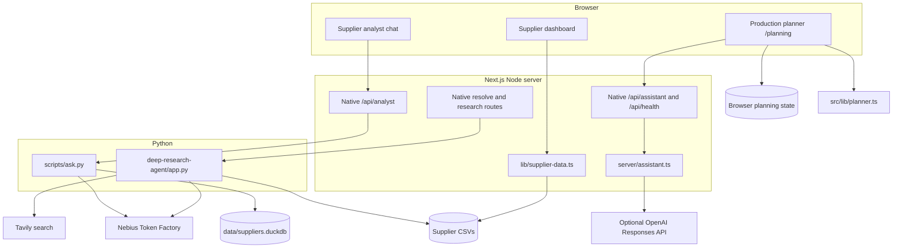

# Architecture

The Next.js application serves the DSX POD overview at `/`, supplier intelligence at `/suppliers`, component recovery at `/planning?component=ID`, and manufacturing planning at `/planning`. Every workflow uses Simon’s frontend as its shared design template. See [the DSX overview](DSX_OVERVIEW.md) for 3D interaction and push alerts. This document describes their separate data models, native API routes and optional AI providers. For the agent's internal pipeline (criteria
sub-agents, prompts, failure handling) see
[deep-research-agent/OVERVIEW.md](../deep-research-agent/OVERVIEW.md); for its
CLI options see [deep-research-agent/README.md](../deep-research-agent/README.md).

## System overview



One Next.js process serves both views and their native API routes. Supplier
research and analyst routes start Python child processes and stream progress.
The company research backend remains available to API and CLI clients. The
dashboard has no Research agent, supplier comparison or Decision memo UI.
Supplier pages query CSV files with embedded DuckDB; the text-to-SQL analyst
uses a separately generated DuckDB file. No database server is required.

The production assistant runs directly in Node through
`server/production-api.ts` and `server/assistant.ts`. It needs no Python
process, local proxy or separately running API server. `server/index.ts`
remains available for standalone HTTP tests and the bounded live check.
The Docker configuration packages Node.js and Python together.

Supplier records are not yet joined to the production planner's synthetic
factory and order data. Shared navigation connects the views, not their
operational data.

## Data flow

### Loading the dashboard

1. `app/suppliers/page.tsx` is a Server Component and calls `getSuppliers()` from
   `lib/supplier-data.ts`. It is rendered per request
   (`dynamic = "force-dynamic"`), so newly researched rows show up on reload.
2. DuckDB (embedded, in-memory) runs one SQL query over
   `data/supplier_risk_dataset.csv`. If the agent has written
   `deep-research-agent/output/suppliers.csv`, those rows are added with
   `UNION ALL`, and their ids are remapped from `SUPP_` to `RSCH_` so they
   never collide with the anonymized dataset.
3. Every row is validated and mapped with a zod schema (scores are integers
   0–100, levels are `Low | Medium | High | Critical`). Invalid data fails
   loudly instead of rendering wrong numbers.
4. The validated list is passed to the client component `SupplierDashboard`,
   which does all filtering, sorting, charting and selection in the browser.
   Selected suppliers focus the charts and provide context to analyst chat.

`@duckdb/node-api` is a native module, so it is listed in
`serverExternalPackages` in `next.config.ts` and loaded with Node's own
`require` instead of being bundled.

### Company research backend

These endpoints remain for API clients. The dashboard no longer starts research.

1. **Resolve the name.** `POST /api/resolve`
   runs `app.py --resolve <name>`: one short model call that turns casual
   input ("stadler") into the official company name ("Stadler Rail AG"). If
   the result differs, the client can review the official name before research.
2. **Research with live progress.** The client calls `POST /api/research`.
   `lib/agent-stream.ts` runs `app.py --json <name>` (5-minute timeout) and
   turns the agent's `PROGRESS|…` lines on stderr into Server-Sent Events, so
   clients can show progress while the research runs.
3. **Score in parallel.** The agent splits the work into eight criteria groups
   (compliance and governance, financial and market, ESG and environmental,
   operations/quality/safety, labor, cyber, geopolitical and political,
   media and external intelligence). Each group is a small LangGraph ReAct
   agent with the Tavily search tool and the MiniMax-M3 model, and returns its
   scores with a reason and source URLs. Up to four groups run at once; a
   whole research takes roughly 30–60 seconds.
4. **Derive levels in code.** Levels and `Total_Risk_Index` are computed in
   `schema.py`, not by the model: a score below 25 is `Low`, below 50
   `Medium`, below 75 `High`, otherwise `Critical`; `Total_Risk_Index` is the
   mean of the 18 dimension scores.
5. **Persist.** The agent appends the row (with a `Last Modified` UTC
   timestamp) to `output/suppliers.csv` and the per-column reasoning to
   `output/suppliers_reasoning.jsonl`, then prints both as JSON.
6. **Return the result.** The route maps the row to the dashboard's supplier
   shape and sends it as the final `result` event. Reloading the supplier
   dashboard reads the persisted CSV row with an `RSCH_` ID.

### Asking the supplier analyst

The visible chat dock uses `components/analyst/use-analyst-chat.ts` to call
`POST /api/analyst`. The route runs `scripts/ask.py` from the repository root.
The script asks Nebius for SQL, executes it against `data/suppliers.duckdb`
in read-only mode with external access disabled, then asks Nebius to explain
the results. Optional structured blocks are validated before rendering.
Follow-up requests include the last successful question, SQL and answer.

Create that database with `scripts/create_duckdb.py` after installing the
Python requirements. It is a snapshot of the tabular files in `data/`;
new company research in `deep-research-agent/output/` is not automatically
added to that analyst database. The dashboard reads those research CSV rows
directly. The older deterministic composer in `lib/analyst/compose.ts` is
not the active chat path. The standalone `deep-research-agent/analyst.py`
provides a separate web-research CLI.

### Planning and confirming production

`app/planning/` mounts the FORMA client UI inside the shared shell. The
planner computes three alternatives from `src/data/network.ts`. It checks
process, material, qualification and capacity, then calculates parallel
component timing, transport, assembly, delivery and cost.

`src/lib/actions.ts` turns current plans and confirmation snapshots into the
prominent Needs action list. Applying quantity or deadline changes recomputes
the plans; stale confirmations require review. State persists in this
browser's local storage. It is not shared across teammates.

The copilot receives bounded, validated current context through
`POST /api/assistant`. It can explain or suggest an existing plan, but cannot
confirm or book it. Without an OpenAI key, or on provider failure, the API
returns an explicitly labelled deterministic fallback. Readiness distinguishes
configured credentials from a successful live reply. See [AI.md](AI.md) for
the exact request and response contract.

## API reference

All endpoints below are native Next.js Route Handlers. Python and provider
keys are needed only for the optional supplier AI features; bundled data and
the planning demo work without them.

| Route | Purpose | Runtime or service |
| --- | --- | --- |
| `POST /api/resolve` | Resolve official company name | Python + Nebius |
| `POST /api/research` | Research and score a company | Python + Nebius + Tavily |
| `POST /api/analyst` | Query supplier dataset and explain results | Python + local DuckDB + Nebius |
| `POST /api/assistant` | Explain or suggest existing production plans | Node; optional OpenAI |
| `GET /api/health` | Production assistant configuration/readiness | Node; no provider call |
| `GET /api/climate` | Location climate summaries | Open-Meteo archive API |
| `GET /api/map-proxy/[...path]` | Supplier map assets | OpenFreeMap |

Supplier Python routes default to `deep-research-agent/.venv/bin/python`.
`ANALYST_PYTHON` can select another interpreter; prefer an absolute path.

### Streaming format

`/api/research` and `/api/analyst` answer with `Content-Type:
text/event-stream`. Each event is one `data:` line with a JSON object:

```text
data: {"type":"progress","text":"Financial & market|started"}
data: {"type":"progress","text":"Financial & market|gathering information"}
…
data: {"type":"result","payload":{ … }}
```

| `type` | Fields | Meaning |
|---|---|---|
| `progress` | `text` (`"<step>\|<status>"`) | A progress step from the agent; any number of these |
| `result` | `payload` | Final result; route-specific, see below |
| `error` | `message` | The agent failed, timed out after 5 minutes or returned no usable result; a missing API key shows up as `agent exited with code 2` |

The stream ends after `result` or `error`. Because the status is only known
after the stream has started, agent errors arrive as `error` events with HTTP
status `200`. `lib/agent-events.ts` (`streamAgent`) is the client-side reader.

```bash
curl -N localhost:3000/api/research \
  -H 'Content-Type: application/json' \
  -d '{"name": "Stadler Rail AG"}'
```

### `POST /api/resolve`

Turns a casual company name into its official name.

Request `{"name": "stadler"}` (required, cut to 200 characters). Response
`200`: `{"canonical": "Stadler Rail AG"}`. If the resolver fails or takes
longer than 30 seconds, `canonical` is the input unchanged. `400`
`{"error": "Missing name"}` for an empty name.

### `POST /api/research`

Researches and scores one real company; streamed as described above.

Request:

```json
{ "name": "Stadler Rail AG" }
```

`name` is required, trimmed and cut to 200 characters; an empty name returns
`400` `{"error": "Missing supplier name"}` as plain JSON.

`payload` of the `result` event:

```json
{
  "supplier": {
    "id": "RSCH_00001",
    "name": "Stadler Rail AG",
    "risk": 42,
    "level": "Medium",
    "financial": 40,
    "quality": 60,
    "operational": 45,
    "compliance": 55,
    "esg": 25,
    "digital": 70,
    "governance": 50,
    "credit": 30,
    "delivery": 0,
    "exposure": 0,
    "sourcing": "Medium",
    "researched": true
  },
  "reasoning": {
    "supplierID": "SUPP_00001",
    "Supplier Name": "Stadler Rail AG",
    "columns": {
      "Financial_Health_Score": {
        "value": 40,
        "reason": "Short justification citing the findings …",
        "sources": ["https://…"]
      }
    }
  }
}
```

`reasoning.columns` contains one `{value, reason, sources}` entry for every
CSV column, including `Last Modified`. `delivery` and `exposure` are `0`
because delivery rating and purchase-order volume come from ERP data, not from
web research.

### `POST /api/analyst`

Answers a question about the local supplier dataset, streamed as above.

Request: `{"question":"Which suppliers have the highest financial risk?"}`.
Questions are trimmed and cut to 500 characters. An empty question returns
`400` with `{"error":"Missing question"}`. Optional `previous` contains
`question`, `sql` and `answer` from the prior successful turn.

The final payload contains `sql`, `answer` and nullable `render`. A non-null
`render` contains validated answer blocks; invalid blocks are dropped while
the textual answer is retained. This route does not invoke the standalone
web-research analyst.

### Production assistant routes

`POST /api/assistant` and `GET /api/health` use a shared request handler.
The assistant checks same-origin browser requests, caps the streamed body at
96 KiB, limits active requests and bounds provider time. A missing Origin
header permits command-line clients; this is not authentication. Responses
are uncached and provider errors are redacted.

Readiness is process-local. A successful live reply verifies the current
process; restarts and separate serverless instances begin unverified. The
health route does not itself contact OpenAI. [AI.md](AI.md) documents the
full contract, fallback and live-verification command.

## Risk scores

The dataset and the agent use the same column schema; definitions are in
[data/risk_criteria_description.md](../data/risk_criteria_description.md).
All scores run from 0 (no risk) to 100 (maximum risk), also for dimensions
named "health", "stability" or "performance".

The anonymized dataset's `Total_Risk_Index` is a weighted average whose
weights were not provided. For researched companies it is the unweighted mean
of the 18 dimension scores, so the two are comparable in scale but not
derived identically.

## Configuration

Use the ignored root `.env` or the server environment. Never expose keys
with a `NEXT_PUBLIC_` or `VITE_` prefix. The two AI providers are independent.

| Variable | Default | Purpose |
| --- | --- | --- |
| `NEBIUS_API_KEY` | Unset | Optional supplier analyst and research inference |
| `TAVILY_API_KEY` | Unset | Optional company web research |
| `NEBIUS_MODEL` | `MiniMaxAI/MiniMax-M3` | Supplier model |
| `NEBIUS_BASE_URL` | `https://api.tokenfactory.nebius.com/v1` | Supplier inference endpoint |
| `ANALYST_PYTHON` | Project agent virtual environment | Python interpreter; Docker uses `/usr/local/bin/python3` |
| `ANALYST_SCRIPT` | `scripts/ask.py` | Dataset analyst entry point |
| `OPENAI_API_KEY` | Unset | Optional production-planning copilot |
| `OPENAI_MODEL` | `gpt-6-astra` | Production-planning model |
| `API_PORT` | `8789` | Retained standalone Node HTTP adapter only; Next uses port 3000 |
| `REDIS_URL` | Unset | Optional cache; otherwise process-local memory |

## Design decisions

- **Child process instead of an agent service.** The routes spawn the Python
  agent directly. That keeps the setup to one `npm run dev` (or one
  container) with no second server to start, at the cost of a Python start-up
  per request. Progress is streamed from the child process's stderr, so the
  user still sees what the agent is doing.
- **One focused sub-agent per criteria group.** Splitting research and
  scoring into eight parallel groups cut a research from about 75–90 seconds
  (one Deep Agent plus one large extraction call) to roughly 30 seconds, and
  a failing group falls back to documented middle-range defaults instead of
  failing the whole supplier.
- **Separate AI contexts.** Supplier questions use the local dataset and
  Nebius. Production suggestions use the current synthetic plans and OpenAI.
  The planning rules and confirmation decisions remain deterministic.
- **CSV + DuckDB instead of a database.** The dataset ships as CSV; DuckDB
  queries it in-process with SQL, and researched rows are just another CSV
  in the same query.
- **Scores from the model, levels from code.** The model only produces
  scores, reasons and sources; level thresholds and the total index are
  deterministic, so all rows are scored consistently and every number is
  traceable to its sources in `suppliers_reasoning.jsonl`.

## Limitations

- Agent scores are model estimates based on public web sources. They are a
  starting point for due diligence, not a verified rating; check the cited
  sources before acting on them.
- Research runs inside the HTTP request (5-minute timeout); there is no job
  queue, and closing the dialog does not cancel the agent process.
- Researched rows are stored in a local CSV file (in Docker: the
  `agent-output` volume), so they exist only where the research ran.
- ERP columns (purchase-order volume, delivery rating, order change and
  confirmation rate) stay empty for researched companies.
- The dataset analyst requires a generated database and a Nebius key; live
  supplier AI has not been verified during this integration.
- Older research CSVs may lack the `Last Modified` column. Back up and migrate
  those records before using the new schema; preserve existing research.
- Planning uses synthetic data and three fixed alternatives. It has no real
  bookings, shared capacity reservations or operational database. See
  [PRODUCTION_PLANNING.md](PRODUCTION_PLANNING.md) for model assumptions.
- Live OpenAI access remains unverified until a configured key passes the
  bounded live check. The app has no user authentication or public deployment.
